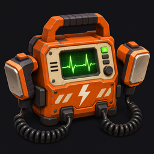

# Ciriolator — versión de pruebas 0.2.1



Mod de BepInEx para Lethal Company, con **v81 como versión objetivo**. Objeto **Ciriolator**, comprable temporalmente por **0 créditos** para validar en el juego, reutilizable y con espera global entre reanimaciones.

**Estado:** código compilado y pruebas de la lógica de servidor superadas. No se ha ejecutado Lethal Company en este entorno. La compra, la reanimación, los efectos secundarios y la compatibilidad multijugador siguen pendientes de validación en el juego. No es una versión estable certificada para el perfil completo.

## Descargar para Thunderstore Mod Manager

[Descargar Ciriolator 0.2.1 (ZIP para importar como mod local)](https://github.com/ciriolopipado/desfibrilatorModLethal/raw/refs/heads/main/downloads/ciriolopipado-Desfibrilator-0.2.1.zip)

Si el navegador no descarga directamente, abre [el archivo en GitHub](downloads/ciriolopipado-Desfibrilator-0.2.1.zip) y pulsa **Download raw file / Descargar archivo sin procesar**. Si el repositorio es privado, inicia sesión con una cuenta que tenga acceso. No necesitas descargar ni compilar el código fuente: importa ese ZIP, sin descomprimir, desde **Settings → Profile → Import local mod**. Los detalles están en la sección de instalación.

## Aviso de seguridad de la descarga

Se ha comunicado un bloqueo de 0.1.0 como «caballo de Troya» en Chrome. La revisión estática no confirma que sea un falso positivo; no hay un análisis antivirus actualizado en este entorno. La versión 0.2.1 sigue sin firma Authenticode; estos cambios no garantizan que desaparezca el aviso. Consulta [SECURITY.md](SECURITY.md) antes de instalar si tu protección bloquea el archivo. La descarga original 0.1.0 se conserva sin cambios.

## Funcionamiento

- Equipa el objeto en la mano activa y apunta a un cadáver cercano y recuperable, a un máximo aproximado de 2,5 metros de la cámara.
- Mantén **E durante 5 segundos**. Soltar, alejarse, perder el objetivo, cambiar de objeto, morir o terminar la ronda cancela el proceso sin consumir la espera.
- El jugador vuelve junto al cuerpo con **30 puntos de vida** e inventario vacío. Los objetos soltados permanecen donde cayeron; el mod no crea ni elimina esos objetos.
- Se inicia una **espera de 90 segundos para toda la partida**, compartida entre todas las unidades, jugadores y cadáveres. No se pueden completar reanimaciones simultáneas. Cambiar o soltar el desfibrilador no evita la espera.
- La cuenta atrás aparece mientras se lleva equipado. Se sincroniza también con jugadores que se incorporan a la partida.
- Sin este objeto en la mano activa, se conserva la interacción normal de recoger cadáveres.
- Se rechazan cuerpos decapitados, desactivados, no recuperables, sujetos por otro jugador/enemigo, con partes físicas ausentes o asociados a jugadores desconectados. Si un mod conserva objetos en el inventario del muerto, la reanimación se bloquea para no destruirlos ni duplicarlos.
- Se necesita un espacio libre con suelo junto al cadáver. Los cambios de escena y el fin de ronda invalidan la carga; no se recuperan cuerpos de expediciones anteriores.

Incluye modelo original generado por código: carcasa naranja, pantalla, cruz, asa, cables y dos palas; sonidos originales sintetizados de carga y descarga. Utiliza una pose básica de sujeción del juego y mueve las palas al cargar. **Todavía no incluye una animación propia de las manos colocando ambas palas sobre el pecho**; requiere trabajo y pruebas adicionales dentro de Unity/juego. La escala y orientación del modelo también necesitan revisión visual en v81.

## Instalación de prueba

Todos los participantes necesitan las mismas versiones del mod y de sus dependencias:

- `BepInEx-BepInExPack-5.4.2305`.
- `Evaisa-LethalLib-1.2.0` y las dependencias que Thunderstore instale con él.

Ambos paquetes ya están en el perfil **Lloreria LETHAL 2**. El mod utiliza Unity Input System directamente; no añade otra versión de InputUtils.

1. Duplica el perfil en Thunderstore Mod Manager para las pruebas.
2. Entra en **Settings / Configuración → Profile / Perfil → Import local mod**. También puedes buscar «Import local mod» en los ajustes.
3. Selecciona **`ciriolopipado-Desfibrilator-0.2.1.zip` sin descomprimirlo** y confirma la importación. Si solicita datos: nombre `Desfibrilator`, autor `ciriolopipado`, versión `0.2.1` (campos `0`, `2`, `1`). Comprueba que el mod esté activado. Si habías copiado sus DLL manualmente, retira esa copia antes de importar para evitar duplicados.
4. Inicia con mods y comprueba en `BepInEx/LogOutput.log` el mensaje `Ciriolator 0.2.1 loaded`.
5. Busca `Ciriolator` en la tienda del terminal y realiza las pruebas de [docs/pruebas.md](docs/pruebas.md).

El paquete sigue llamándose `Desfibrilator` en el gestor para actualizar la instalación existente. El objeto dentro del juego se llama **Ciriolator** y cuesta **0 créditos** en esta versión de pruebas. Reinicia el juego tras actualizar; todos los participantes deben usar 0.2.1.

No hace falta publicar el mod ni compilarlo en tu ordenador. Cada participante debe importar el mismo ZIP. El paquete incluye `LEEME_INSTALACION.txt` con estos pasos. Como alternativa manual, copia únicamente su contenido de `BepInEx/plugins/Desfibrilator/` a la ruta equivalente del perfil, sin mantener otra instalación del mismo mod.

Tras iniciar una vez, la tecla se configura en `BepInEx/config/ciriolopipado.desfibrilator.cfg`, sección `Controls`, propiedad `Defibrillate`. Valor por defecto: `<Keyboard>/e`. Admite otras rutas de Unity Input System; reinicia tras cambiarlo. El texto de ayuda menciona E como tecla predeterminada, aunque se cambie la asignación.

## Efectos secundarios tras revivir

Desde 0.2.1, los efectos se aplican solo a los jugadores reanimados con Ciriolator:

- **Últimas palabras:** captura automáticamente un fragmento de hasta 5 segundos de tu última intervención transmitida por el chat de voz antes de morir. Se repite con una ligera coloración de audio cada **60–120 segundos**, desde la posición del reanimado, con alcance aproximado de **12 metros**. No se envía por los walkie-talkies.
- El anfitrión emite ruido del juego durante esas reproducciones: puede atraer a los enemigos que reaccionan al sonido. No obliga a todos los enemigos a perseguir al jugador.
- **Descargas:** cada **45–90 segundos** se aplica una desviación aleatoria horizontal (4–10°) y vertical (2–6°), sin daño y **sin recentrado automático**. La intensidad se configura con `SideEffects.CameraStrength` (0–1; 0 desactiva el movimiento en ese equipo).
- Al morir, los efectos se suspenden. Otra reanimación renueva los temporizadores y la última frase sin acumular efectos. Las frases y el estado se eliminan al llegar a órbita o desconectarse.

**La captura empieza automáticamente durante cada expedición, sin pulsar F8 ni realizar una activación previa.** Basta con hablar por la voz de partida: respeta el silencio y pulsar para hablar. Guarda la última intervención anterior aunque no se hable justo antes de morir; no hace falta seleccionar una frase aleatoria. Si no se ha hablado o no existe un fragmento válido, no se reproduce voz ni se genera su ruido; las descargas siguen funcionando.

Se puede desactivar localmente con `LastWords.AutomaticVoiceCapture=false` y reiniciando el juego. Las antiguas opciones `RecordOwnVoice` y `ToggleLastWordsRecording` de 0.2.0 se ignoran: actualizar no requiere borrar el archivo de configuración ni cambiar su antiguo valor false. Aparece un aviso visible de captura automática al entrar. Si se desactiva mediante una herramienta que recargue la configuración durante la partida, se elimina la frase propia y se solicita retirarla del anfitrión y de los compañeros.

El audio permanece en memoria; nuestro mod no crea archivos de grabación ni los envía a servicios externos. Solo comparte el fragmento propio con el anfitrión y los compañeros conectados para esta función. Otros mods, como Mirage, tienen sus propias políticas de grabación que este mod no modifica. No utiliza ni importa los archivos de audio de Mirage. Consulta [docs/efectos-secundarios.md](docs/efectos-secundarios.md).

## Compilación

Requisitos: .NET SDK 8 y Python 3. No hace falta un servidor web ni servicios de base de datos. Trabaja en este checkout; no crees otro worktree salvo que se solicite.

### Con referencias de tu instalación de v81 — recomendado

El perfil `.r2z` exporta versiones y configuración, **no los DLL del juego**. Para compilar contra tu instalación real:

```sh
python scripts/prepare-local-refs.py --managed "/ruta/Lethal Company/Lethal Company_Data/Managed" --profile "/ruta/perfil/Lloreria LETHAL 2"
dotnet build src/Desfibrilator/Desfibrilator.csproj -c Release -p:LocalReferenceDirectory="/ruta/checkout/.local/v81-refs"
dotnet run --project tests/Desfibrilator.Tests -c Release
python scripts/package.py
```

Las rutas deben sustituirse por las de tu equipo; también funciona en Windows. Los DLL de referencia se guardan en `.local/`, se ignoran en Git y no se distribuyen en el paquete.

### Referencias públicas para desarrollo en la nube

```sh
python scripts/prepare-reference-snapshot.py
dotnet build src/Desfibrilator/Desfibrilator.csproj -c Release
dotnet run --project tests/Desfibrilator.Tests -c Release
python scripts/package.py
```

Este segundo flujo prepara `LethalCompany.GameLibs.Steam 81.0.5-ngd.0`, con las API públicas de v81 y Dissonance, en `.local/reference-v81`. Usa BepInEx API 5.4.21, Unity reference modules 2021.3.33 para las API compartidas y LethalLib 1.2.0. Se ha comprobado la compilación de esta versión contra las referencias de juego v81, pero **no se ha ejecutado el juego ni validado su comportamiento dentro de Unity**. El script conserva TLS y verifica SHA-256. No distribuye las bibliotecas del juego ni Dissonance dentro del ZIP.

En esta máquina, el SDK está en `/workspace/.tools/dotnet`. Antes de usarlo:

```sh
export DOTNET_CLI_HOME=/workspace/.tools/dotnet-home
export DOTNET_CLI_TELEMETRY_OPTOUT=1
export PATH=/workspace/.tools/dotnet:$PATH
```

## Validación y compatibilidad

Las 35 pruebas automáticas ejercitan la reanimación, captura acotada y recorte de voz, intervalos, suspensión, limpieza y permisos de subida ligados al emisor, expedición y muerte. Se comprueban también tamaños máximos, mensajes truncados, duplicados y revocación. No sustituyen pruebas de físicas, inventario, cámara, voz o transporte de red dentro de Unity.

El anfitrión valida distancia, obstáculos, equipo activo, estado del cuerpo y conexión del objetivo. El cliente envía señales periódicas de que mantiene la acción y el objetivo; el servidor exige cinco segundos de esas señales. Esto evita que un cliente complete la carga anticipadamente, pero no constituye una protección frente a clientes modificados que falsifiquen la pulsación o el apuntado.

El inventario del perfil recibido está en [docs/profile-inventory.json](docs/profile-inventory.json): 294 paquetes, 293 activos. No se ha demostrado ningún conflicto. Las prioridades de prueba son **MoreCompany 1.14.0**, **Poltergeist 1.2.12**, **HotbarPlus 1.8.6**, **ReviveDesyncPatch 1.0.0**, los cambios de cámara/HUD y los efectos de Lategame Upgrades/Emergency Dice. No se desactiva ni modifica ninguno de estos mods. La limpieza del estado de fantasma de Poltergeist requiere validación específica.

Se usa mensajería de Unity Netcode con identificadores de cliente y de objeto; no se fija un máximo de cuatro jugadores. No se llama a `ReviveDeadPlayers()`, que reanimaría a todos los muertos y alteraría el flujo de fin de ronda. No se modifica el contador `playersRevived`, reservado por el juego para ese flujo.

Todos los participantes deben actualizar a 0.2.1 para tener la captura automática. Las versiones anteriores a 0.2.0 usan un protocolo de reanimación incompatible.

El ZIP se genera en `dist/ciriolopipado-Desfibrilator-0.2.1.zip`. El nombre permite al importador deducir autor, nombre y versión. La copia descargable de esta versión está en `downloads/`, junto con su SHA-256. Sigue siendo una compilación experimental y no se ha publicado en el catálogo de Thunderstore.
